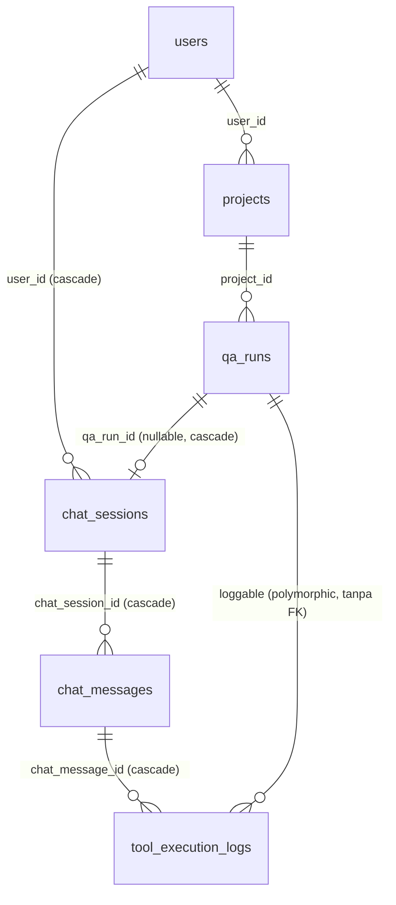

# PRD — Auto QA: Breeze, Transkrip Agent, API Chat Terproteksi, Streaming, dan Fallback Model

| Item | Nilai |
|---|---|
| Repo | `github.com/hisyamssyr/auto-qa-app` |
| Baseline yang dianalisis | commit `1500ddf` (2026-11-15), "feat: switch default LLM to campus Senopati gateway", yaitu `fc0ceb3` ditambah konfigurasi gateway kampus. Baseline uji: 223 test / 887 assertion hijau |
| Tanggal PRD | 2026-11-15 |
| Status | **Diimplementasikan (v1.3).** Breeze, skema chat, transkrip, API chat, riwayat, streaming, prompt tema, dan fallback sudah masuk repo; lihat tabel status §11 |
| Pembaca utama | Pengembang dan AI agent yang akan mengimplementasikan update |
| Konteks | Tugas kuliah: Pemodelan Relasi Agentic AI Platform (Week 1) dan Secure LLM Chat API Hub (Week 2) |
| Revisi | v1.3 (2026-11-15): implementasi WS0–WS8 selesai; **Breeze wajib** terpasang (§3.14, WS0); kemampuan gateway kampus diverifikasi (§3.13); basis data **tetap SQLite** (§8.8) |

---

## 1. Ringkasan

Auto QA adalah aplikasi Laravel 13 + Livewire 4 yang menguji website lewat browser (Playwright), mengusulkan perbaikan, memverifikasinya di Docker, lalu membuka draft pull request. Autentikasi **wajib memakai Laravel Breeze** (Blade), menggantikan `AuthController` kustom (§3.14). Model bahasa di repo sudah diarahkan ke gateway kampus Senopati AI ITS (`qwen3:14b`) melalui konfigurasi `MODEL_*` (§3.8, §3.13). Basis data tetap **SQLite**; tidak ada migrasi ke DBMS lain.

Update ini menambahkan lima kemampuan **tanpa mengubah perilaku QA yang sudah ada**:

0. **Breeze wajib.** Pasang Breeze 2.4.x (Blade), gunakan model `User` standar Breeze, dan pertahankan aturan single-operator, preferensi locale/theme, serta dashboard Livewire yang sudah ada.
1. **Transkrip agent yang tersimpan.** Setiap panggilan model dan setiap pemanggilan alat browser oleh agent direkam ke tabel relasional (`ChatSession`, `ChatMessage`, `ToolExecutionLog`).
2. **API chat terproteksi.** Endpoint `POST /api/chat-ai` di bawah Laravel Sanctum untuk bertanya langsung ke LLM, dengan validasi `FormRequest` dan respons `API Resource`.
3. **Riwayat yang efisien.** Endpoint dan halaman riwayat dengan eager loading bertingkat yang bebas N+1.
4. **Challenge:** streaming SSE, system prompt bertema, dan fallback otomatis ke model kampus.

Sumber kebenaran adalah **repo ini**. Deskripsi tugas dosen hanya diikuti bila kompatibel dengan repo atau memang bisa diubah (lihat §4).

---

## 2. Prinsip keputusan

1. **Repo adalah acuan.** Pola yang sudah ada (Livewire, queue database, SQLite, `decide()` JSON) dipertahankan; auth kustom diganti Breeze karena requirement dosen.
2. **Perubahan bersifat aditif, kecuali Breeze.** Tidak ada perubahan pada tipe kembalian `ModelClient::decide()`, nama status run, atau ekspektasi test non-auth. Penggantian `AuthController`/view/route auth oleh Breeze adalah pengecualian wajib (WS0); `AuthTest` disesuaikan. Test existing memakai Mockery untuk `ModelClient`, `BrowserWorker`, dan `GitHubAppClient`.
3. **Urutan fase tidak wajib berurutan**, tetapi ada dependensi (lihat §11). Fallback dikerjakan paling akhir.
4. **Jujur soal yang belum teruji.** Kemampuan gateway kampus yang sudah diverifikasi dicatat sebagai terverifikasi (§3.13); kuota/rate limit dan fallback nyata tetap ditandai *belum teruji*.
5. **SQLite tetap.** Semua rancangan harus berjalan di SQLite; tidak ada fitur yang bergantung pada MySQL/PostgreSQL.
6. **Jangan mengirim parameter yang tidak diketahui didukung gateway kampus.** Untuk endpoint chat, body dibuat minimal dan parameter tambahan bersifat opsional lewat konfigurasi. Hal yang sudah diverifikasi boleh dipakai, tetapi tetap dijaga lewat konfigurasi (§3.13).
7. **Breeze wajib.** Autentikasi memakai `laravel/breeze` 2.4.x stack Blade. Scaffolding Breeze boleh menimpa view/layout, tetapi perilaku produk yang ada—single-operator, locale/theme, dashboard Livewire—harus dipertahankan (§3.14, WS0).

---

## 3. Current state (baseline `fc0ceb3` + gateway `1500ddf`)

### 3.1 Stack

| Lapisan | Teknologi (dari `composer.json`, `package.json`, README) |
|---|---|
| Bahasa/runtime | PHP `^8.3` (README: dikembangkan dengan 8.5), Node 22+ |
| Framework | `laravel/framework ^13.17`, `livewire/livewire ^4.4`, `laravel/tinker ^3.0` |
| Autentikasi web | **`laravel/breeze ^2.4` (Blade) — wajib dan terpasang**. Versi 2.4.2 mendukung Laravel 13 (§3.14) |
| Autentikasi API | `laravel/sanctum 4.4.x` (terpasang; mendukung Laravel 13) |
| Dev | `laravel/boost`, `laravel/pail`, `laravel/pao`, `laravel/pint`, `phpunit ^12.5.12`, `mockery`, `fakerphp/faker`, `nunomaduro/collision`; tambahan `barryvdh/laravel-debugbar 4.4.x` (terpasang) |
| Frontend | Vite 8, Tailwind 4 (`@tailwindcss/vite`), `laravel-vite-plugin` |
| Database | SQLite (default `.env.example`), session/cache/queue di database. **Dipertahankan.** `config/database.php`: `foreign_key_constraints` = `env('DB_FOREIGN_KEYS', true)`; `busy_timeout`, `journal_mode`, `synchronous` bernilai `null` (hardcoded, bukan dari env); `transaction_mode` = `DEFERRED` |
| Browser worker | Node + Playwright Chromium, port 3001, satu sesi sekaligus |
| Sandbox | Docker (`sandbox/runner.php` dijalankan di dalam image tepercaya) |
| Lockfile | `composer.lock`, `package-lock.json`, `worker/package-lock.json` ter-commit |

### 3.2 Arsitektur: tiga proses

1. **Laravel app**: UI Livewire, auth, job queue (`ExecuteQaRun`, timeout 1800 detik, `WithoutOverlapping('autoqa-heavy')` bersama).
2. **Browser worker** (`worker/*.mjs`): HTTP server dengan bearer token. Mengambil snapshot halaman (maksimal 80 elemen, teks 4000 karakter), menjalankan aksi, menyimpan screenshot dan trace.
3. **Repair sandbox** (`RepairSandbox` + `sandbox/runner.php`): container Docker tanpa network, read-only, 2 GB RAM, 1 CPU, 128 proses, semua capability dibuang.

### 3.3 Alur run (`QaAgent::run`)

1. Run berstatus `queued`, lalu `testing`. `TargetPolicy` memeriksa URL target.
2. `BrowserWorker::start` membuka sesi. Loop maksimal `min(40, AUTOQA_MAX_STEPS)` (default 25). Tiap iterasi: `ModelClient::decide(...)` menghasilkan satu aksi JSON, divalidasi `validateAction`, lalu dijalankan lewat `BrowserWorker::act`.
3. Aksi yang diizinkan: `click`, `fill`, `select`, `press`, `navigate`, `assert_text`, `assert_url`, `finish`. Klaim `finish: passed` ditolak kecuali minimal satu assertion browser lolos.
4. `observeFailure` membuat `Finding` jika ada respons HTTP >= 500 atau assertion gagal, dan mengambil screenshot.
5. Jika ada kegagalan: fase repair (`diagnosing`, `repairing`): model memilih file, menulis patch dan regression test, merencanakan control journey; `RepairSandbox::verify` menjalankan enam gate; bila semua lolos, `GitHubAppClient` membuat branch `agent/fix-*` dan draft PR.
6. Status run: `queued`, `testing`, `diagnosing`, `repairing` (non-terminal); `completed`, `failed`, `cancelled`, `blocked`, `needs_configuration`, `verification_failed`, `suggestion_ready`, `ready_for_review` (terminal; `Dashboard::TERMINAL_STATUSES`).

### 3.4 Komponen kode

| File | Tanggung jawab |
|---|---|
| `app/Services/QaAgent.php` (346 baris) | Orkestrasi run, validasi aksi, redaksi password, repair, publikasi |
| `app/Services/ModelClient.php` (58) | `health()` dan `decide()`: POST `/chat/completions`, `temperature 0.7`, `max_tokens 6144`, `response_format json_object`, menambahkan `/no_think` dan instruksi "Return only a JSON object", membuang `<think>...</think>`, menolak `finish_reason: length`. Mengembalikan **hanya** array hasil parse (usage, model, dan teks mentah dibuang) |
| `app/Services/BrowserWorker.php` (109) | Klien HTTP ke worker; validasi nama file bukti |
| `app/Services/TargetPolicy.php`, `worker/policy.mjs` | Kebijakan target (`public` / `local`) di PHP dan Node |
| `app/Services/PatchPolicy.php`, `RepairSandbox.php` | Batas patch (5 file, 64 KB, hanya `app/`, `resources/views/`, `routes/`, `tests/Feature/`) dan enam gate verifikasi |
| `app/Services/GitHub/GitHubAppClient.php` (503) | JWT GitHub App, baca source, commit repair, draft PR |
| `app/Jobs/ExecuteQaRun.php` | Job queue; `failed()` menandai run `failed` |
| `app/Livewire/Dashboard.php` (318), `dashboard.blade.php` (605) | UI tunggal: proyek, run, pengaturan; aksi `startRun`, `cancelRun`, `checkConnection`, `saveProject`, dll. |
| `app/Http/Controllers/AuthController.php` | Auth kustom baseline; **dihapus dan diganti controller/request Breeze** (§3.14) |
| `app/Http/Controllers/Auth/*`, `app/Http/Requests/Auth/*`, `routes/auth.php` | Scaffolding Breeze untuk login/register/logout (dan fitur opsional yang dipertahankan); lihat WS0 |
| `app/Http/Controllers/PreferencesController.php` | Simpan `locale` (`en`/`id`) dan `theme` (`light`/`dark`) ke `users` plus cookie |
| `app/Http/Controllers/EvidenceController.php` | Mengirim screenshot/trace; rute dibatasi regex `browser-[a-zA-Z0-9-]+\.(png\|zip)` |
| `app/Http/Middleware/ApplyUiPreferences.php` | Menerapkan preferensi UI ke grup `web` |

### 3.5 Data yang ada

| Tabel | Kolom penting |
|---|---|
| `users` | bawaan Laravel + `locale` (2, default `en`), `theme` (5, default `light`) |
| `projects` | `user_id` (FK cascade), `name`, `repository_url`, `website_url`, `target_mode`, `goal`, `expected_behavior`, `base_branch`, `deployed_sha`, `repair_policy` (default `suggest_only`), `connection` (json) |
| `qa_runs` | `project_id` (FK cascade), `status` (index), `goal`, `expected_behavior`, `base_sha`, `patch_files`/`verification`/`report` (json), `error`, `pr_url`, `started_at`, `finished_at` |
| `run_steps` | `run_id` (FK `qa_runs`, cascade), `sequence`, `kind`, `summary`, `data` (json), unique `(run_id, sequence)` |
| `findings` | `run_id` (FK cascade), `title`, `severity`, `status`, `expected`, `actual`, `evidence` (json) |
| `jobs`, `cache`, `sessions`, dll. | bawaan Laravel |

Kepemilikan: `User -> Project -> QaRun -> (RunStep, Finding)`. `QaRun` tidak punya `user_id` langsung.

Tidak ada tabel yang menyimpan prompt, jawaban mentah, nama model, atau jumlah token.

### 3.6 Rute

| Rute | Middleware | Keterangan |
|---|---|---|
| `GET /` | - | Redirect ke `dashboard` atau `login` |
| `GET/POST /login` | `guest` | Setelah Breeze: `AuthenticatedSessionController`; rate limit di `LoginRequest` (5 percobaan per email+IP) |
| `GET/POST /register` | `guest`; POST `throttle:5,1` | Setelah Breeze: `RegisteredUserController`; **hanya sebelum ada user pertama** |
| `POST /settings/preferences` | `auth` | Tetap dipertahankan untuk locale/theme |
| `GET /dashboard` | `auth` | Komponen Livewire `Dashboard`; layout kustom dipertahankan |
| `GET /runs/{run}/evidence/{filename}` | `auth` | |
| `POST /logout` | `auth` | Setelah Breeze: `AuthenticatedSessionController@destroy` |
| `GET /up` | - | Health check bawaan |

`routes/auth.php` dari Breeze didaftarkan melalui `routes/web.php`. Fitur Breeze yang tidak diperlukan—email verification dan profile terpisah—boleh dihapus dari `routes/auth.php`; password reset opsional dan hanya dipertahankan bila mail dikonfigurasi. Detail di §3.14/§8.0.

**Tidak ada `routes/api.php`.** `bootstrap/app.php` hanya mendaftarkan `web`, `commands`, dan `health`. Sudah ada `shouldRenderJsonWhen` untuk `api/*`.

### 3.7 Autentikasi

- Guard `web` (session, provider Eloquent). Tidak ada Sanctum dan tidak ada `HasApiTokens`.
- **Registrasi hanya untuk operator pertama.** Setelah ada satu `User`, `/register` mengarahkan ke login dan `register()` memberi 403. Penciptaan operator pertama memakai `Cache::lock('autoqa-first-operator')` + transaksi. Password minimal 12 karakter.
- Baseline **bukan Breeze**. Model `User` memakai atribut `#[Fillable(['name','email','password','locale','theme'])]` dan `#[Hidden]`, tanpa relasi.

**Revisi v1.2 — target wajib Breeze.** Pasang `laravel/breeze ^2.4` dengan stack Blade. `AuthController` kustom dan view `auth/login`/`auth/register` diganti scaffolding Breeze (`routes/auth.php`, `app/Http/Controllers/Auth/*`, `app/Http/Requests/Auth/*`, `resources/views/auth/*`). Perilaku yang wajib dipertahankan:

- Registrasi tetap hanya untuk operator pertama: `RegisteredUserController` memakai `Cache::lock('autoqa-first-operator')`, transaksi, normalisasi email lowercase, dan `Password::min(12)`; `/register` diarahkan ke login bila user sudah ada.
- Login Breeze menggunakan throttle 5 percobaan per email+IP dan redirect ke `dashboard`.
- Logout Breeze menghapus sesi dan redirect ke `login`.
- `ApplyUiPreferences` dan `PreferencesController` tetap berlaku; Breeze tidak boleh menghapus dukungan locale/theme.
- Model `User` mengikuti model standar Breeze; atribut `locale`/`theme` tetap fillable dan `HasApiTokens` ditambahkan pada WS3.
- Dashboard Livewire, layout kustom, CSS, dan i18n tidak boleh berubah perilakunya.

### 3.8 Konfigurasi (`config/autoqa.php`, `.env.example`)

`MODEL_URL` (default repo saat ini `https://senopati.its.ac.id/llm-gateway/v1`), `MODEL_NAME` (`qwen3:14b`), `MODEL_TIMEOUT` (config default 90; `.env.example` 180), `MODEL_API_KEY`, `AUTOQA_MAX_STEPS` (25), `BROWSER_WORKER_URL/TOKEN/TIMEOUT`, `AUTOQA_LOCAL_TARGETS`, `AUTOQA_RUNNER_IMAGE`, `AUTOQA_PREVIEW_ORIGIN`, `AUTOQA_RUNNER_TIMEOUT`, serta `GITHUB_*` (`config/github.php`).

`ModelClient` menyusun URL sebagai `rtrim(MODEL_URL, '/').'/chat/completions'` dan mengirim `Authorization: Bearer <MODEL_API_KEY>` (atau `local` bila kunci kosong). `health()` memanggil `GET {MODEL_URL}/models` dengan timeout 3 detik; gateway kampus **terbukti memiliki endpoint ini** (2026-11-15). `Dashboard::startRun` hanya memeriksa `ModelClient::ready()` (URL terisi), bukan `health()`. Tetap pertahankan FR-7.6 agar `health()` bukan satu-satunya penentu ketersediaan.

### 3.9 Testing

- PHPUnit (`phpunit.xml`): SQLite `:memory:`, `QUEUE_CONNECTION=sync`, cache dan session `array`.
- Feature: `AuthTest`, `DashboardTest`, `EvidenceTest`, `ExampleTest`, `ExecuteQaRunTest`, `PreferencesTest`, `QaAgentTest`, `RepairSandboxTest`. Unit: `BrowserWorkerTest`, `ExampleTest`, `GitHubAppClientTest`, `GitHubRepositoryUrlTest`, `ModelClientTest`, `PatchPolicyTest`, `TargetPolicyTest`. Worker: `browser`, `browser.integration`, `policy`, `server`.
- Factory: `UserFactory`, `ProjectFactory` (state `local()`, `publishing()`), `QaRunFactory`. Seeder: `DatabaseSeeder` (membuat "Test User"), `PreviewSeeder` (hanya jalan di `APP_ENV=testing` dengan database `/tmp/autoqa-ui-preview-*`).
- Dependensi luar di-mock. **Baseline sebelum implementasi: 223 test / 887 assertion hijau. Setelah implementasi WS0–WS8: 257 test / 1037 assertion hijau.** `AuthTest` sudah disesuaikan dengan route Breeze dan test Breeze bawaan tidak dipakai mentah.

### 3.10 Batasan yang sudah terdokumentasi (README dan docs)

Perbaikan hanya untuk Laravel PHP/Blade kecil (maks. 5 file / 64 KB, kandidat source maks. 6 KB), satu regression test baru, jalur sekuensial, tanpa webhook, tanpa merge atau deploy otomatis. `plans/` ada di `.gitignore`, sehingga dokumen rencana yang ditautkan README tidak ada di repo.

### 3.11 Gap terhadap tujuan update

| Gap | Dampak |
|---|---|
| Prompt, jawaban, model, token tidak disimpan | Tidak ada riwayat interaksi LLM |
| Aksi alat tersimpan hanya sebagai ringkasan `run_steps` | Tidak ada log alat terstruktur per pesan |
| Tidak ada API, Sanctum, `HasApiTokens` | Tidak ada endpoint terproteksi token |
| Validasi inline di Livewire/controller | Tidak ada contoh `FormRequest` |
| `decide()` memaksa JSON dan membuang `<think>` | Tidak cocok untuk jawaban chat teks bebas dan streaming |
| Tidak ada streaming, tidak ada fallback model | |
| `User` tidak punya relasi ke sesi | |
| Autentikasi masih kustom, bukan Breeze | Tidak memenuhi requirement dosen; `AuthController`, routes, dan view harus diganti scaffolding Breeze (§3.14) |

### 3.12 Klarifikasi status skema chat

**Status v1.3:** skema chat sudah diimplementasikan di checkout ini: `database/migrations/2026_11_15_000001_create_chat_tables.php`, model `ChatSession`/`ChatMessage`/`ToolExecutionLog`, relasi pada `User` dan `QaRun`, factory, seeder, serta test cascade/unique. Catatan v1.2 tentang ketiadaan skema dipertahankan sebagai sejarah koreksi.

### 3.13 Gateway kampus Senopati AI ITS

Model di repo sudah diarahkan ke API kampus Senopati AI ITS melalui commit `1500ddf` (`MODEL_URL`, `MODEL_NAME=qwen3:14b`, `MODEL_API_KEY` di `.env` lokal). Kunci asli tidak masuk repo. Bentuk pemanggilan dari pengguna (kunci disamarkan):

```bash
curl https://senopati.its.ac.id/llm-gateway/v1/chat/completions \
  -H "Authorization: Bearer xxx" \
  -H "Content-Type: application/json" \
  -d '{"model": "qwen3:14b", "messages": [{"role": "user", "content": "halo"}]}'
```

Kecocokan dengan kode yang ada: `ModelClient` sudah menambahkan `/chat/completions` ke `MODEL_URL` dan mengirim Bearer dari `MODEL_API_KEY`, sehingga konfigurasinya cukup `MODEL_URL=https://senopati.its.ac.id/llm-gateway/v1`, `MODEL_NAME=qwen3:14b`, `MODEL_API_KEY=<kunci>`. Nama model `qwen3:14b` juga sama dengan contoh respons di tugas dosen.

| Status | Hal |
|---|---|
| **Diketahui** (dari contoh pengguna) | URL endpoint, autentikasi Bearer, body bergaya OpenAI (`model`, `messages` dengan `role` dan `content`), model `qwen3:14b` |
| **Terverifikasi langsung (2026-11-15)** | `GET /models` reachable; `response_format: json_object` diterima (`decide()` mengembalikan JSON valid); respons non-stream memiliki `usage` (`prompt_tokens`, `completion_tokens`, `total_tokens`); streaming SSE didukung; `stream_options.include_usage` mengembalikan `usage` pada chunk terakhir; stream diakhiri `[DONE]` |
| **Perilaku khusus Qwen3** | Reasoning dikirim sebagai `delta.reasoning_content` pada streaming dan `message.reasoning_content` pada non-stream, **bukan** tag `<think>`. `usage.completion_tokens` mencakup token reasoning. Dengan `max_tokens` kecil, seluruh kuota dapat habis untuk reasoning sehingga `content` kosong dan `finish_reason` = `length` |
| **Belum diketahui** | Kuota dan rate limit; latensi tipikal `qwen3:14b`; format error gateway; pengaruh `temperature`; dukungan parameter non-OpenAI di masa depan |

Konsekuensi untuk desain:

- `ModelClient::chat()`/`stream()` hanya memakai `choices.*.message.content` / `delta.content`; **abaikan `reasoning_content`**. Penyaring `<think>` tetap dipertahankan sebagai defensif, tetapi bukan mekanisme utama.
- Jangan mengirim `max_tokens` kecil secara default; `CHAT_MAX_TOKENS` kosong berarti parameter tidak dikirim. Token yang disimpan adalah `usage.total_tokens` bila ada.
- Streaming dan pencatatan `usage` boleh diandalkan, tetapi `CHAT_STREAM_USAGE` tetap default `false` agar kompatibel bila gateway berubah.
- `health()` tetap tidak boleh menjadi satu-satunya penentu ketersediaan (FR-7.6), meskipun `/models` saat ini tersedia.
- Prompt dan konteks halaman target yang dikirim ke gateway diterima server kampus (lihat R15).

### 3.14 Requirement Breeze (wajib, revisi v1.2)

Dosen **mewajibkan Laravel Breeze**. Scaffolding Breeze harus dipakai, bukan sekadar ditambahkan sebagai dependency yang tidak aktif. **Status v1.3: Breeze terpasang**; `AuthController` kustom dan route auth-nya sudah dihapus, diganti `routes/auth.php` serta controller/request Breeze. View auth memakai desain kustom yang sudah ada, dan aturan single-operator dipertahankan.

| Aspek | Baseline | Target wajib |
|---|---|---|
| Package | Tidak ada | `laravel/breeze ^2.4` (diverifikasi v2.4.2 mendukung `illuminate/* ^13.0`) |
| Stack | Auth kustom + Blade | `php artisan breeze:install blade` |
| Model | `User` dengan atribut `#[Fillable]`/`#[Hidden]` | Model `User` standar Breeze; `locale`, `theme`, `HasFactory`, `Notifiable` dipertahankan; `HasApiTokens` ditambahkan pada WS3 |
| Route auth | `AuthController` di `routes/web.php` | `routes/auth.php` berisi `AuthenticatedSessionController`, `RegisteredUserController`, dll. |
| Registrasi | Hanya operator pertama; password min. 12 | Sama; aturan dipindahkan ke `RegisteredUserController` Breeze |
| UI | Layout/dashboard/CSS kustom | Layout/dashboard/CSS kustom **dipertahankan**; view auth Breeze disesuaikan |
| Test | `AuthTest` menguji `AuthController` | `AuthTest` disesuaikan ke route Breeze; tambah test registrasi tertutup dan preferensi |

**Rencana instalasi yang aman (jangan langsung menimpa UI):**

1. Commit/backup `resources/views/layouts/app.blade.php`, `resources/views/livewire/dashboard.blade.php`, `resources/css/app.css`, `routes/web.php`, `package.json`, dan `vite.config.js`.
2. `composer require laravel/breeze:^2.4 --dev`, lalu `php artisan breeze:install blade --no-interaction`.
3. Pulihkan layout/dashboard/CSS kustom. Adaptasi view auth Breeze agar memakai gaya yang ada; jangan biarkan layout Breeze menggantikan `layouts.app`.
4. Ganti `routes/web.php` agar hanya mendaftarkan `routes/auth.php` untuk auth, sambil mempertahankan route `dashboard`, `settings.preferences`, `runs.evidence`, dan `/`.
5. Hapus `app/Http/Controllers/AuthController.php` dan view auth kustom yang sudah tidak dipakai agar tidak ada route/controller ganda.
6. Pindahkan aturan single-operator, normalisasi email lowercase, `Password::min(12)`, dan `Cache::lock` ke `RegisteredUserController@store`; `create()`/`show` mengarahkan ke login bila user sudah ada; tambahkan `throttle:5,1` pada route POST registrasi.
7. Pertahankan `ApplyUiPreferences` dan `PreferencesController`; pastikan `locale`/`theme` masih fillable pada `User`.
8. Hapus route Breeze yang tidak dipakai (email verification, profile terpisah) dari `routes/auth.php`; password reset hanya dipertahankan bila mail dikonfigurasi. Jika memilih mempertahankan profile, gunakan layout kustom dan jangan menduplikasi pengaturan locale/theme.
9. Sesuaikan test Breeze: jangan commit `tests/Feature/Auth/*` bawaan tanpa perubahan; gunakan `LazilyRefreshDatabase`, password min. 12, dan route `dashboard`.
10. Jalankan `npm install`/`npm ci`, `npm run build`, `php artisan test --compact`, dan Pint pada file baru/diubah.

**Batasan:** Breeze menambahkan Alpine dan mungkin mengubah `package.json`, `vite.config.js`, serta CSS. Tailwind 4 yang sudah dipakai harus tetap menjadi satu-satunya pipeline CSS. Bila `breeze:install` menghasilkan konflik Tailwind, pertahankan konfigurasi Tailwind 4 repo dan hanya ambil controller, request, route, serta markup auth yang diperlukan.

---

## 4. Pemetaan requirement dosen ke keputusan

| Requirement dosen | Keputusan | Catatan |
|---|---|---|
| Model `User` bawaan Breeze | **Ya — wajib** | Pasang `laravel/breeze ^2.4` stack Blade; gunakan model `User` standar Breeze; port aturan single-operator, locale/theme, dan pertahankan dashboard Livewire. Lihat §3.14 dan WS0 |
| `ChatSession`, `ChatMessage`, `ToolExecutionLog` | **Ya** | Lihat §8 |
| `User hasMany ChatSession` | **Ya** | `chat_sessions.user_id` langsung |
| Migrations dengan FK + `onDelete('cascade')` | **Ya** | Semua FK cascade |
| Factory untuk data dummy relasional | **Ya** | Plus `ChatDemoSeeder` |
| Polymorphic `morphs('loggable')` | **Ya, disesuaikan** | `chat_message_id` (FK) **dipertahankan** di samping `loggable`. Target `loggable` = model yang sudah ada (`QaRun`), bukan `SecurityScanner`/`MalwareScanner`/`LogAnalyzer` |
| Eager loading bertingkat + bukti Debugbar | **Ya, disesuaikan** | Bukti di halaman HTML; endpoint JSON dibuktikan dengan test jumlah kueri |
| `POST /api/chat-ai` di `auth:sanctum` | **Ya** | |
| `FormRequest` (prompt string, maks. 1000) | **Ya** | `ChatRequest` |
| Tabel log: user, prompt, jawaban, model, token | **Ya** | Lewat `chat_sessions` + `chat_messages` |
| `API Resource` + format `{status, data{...}}` | **Ya** | `ChatResource` |
| Ollama lokal atau Senopati AI ITS | **Ya** | Penyedia diatur lewat `MODEL_*` (utama) dan `FALLBACK_MODEL_*`. Profil A (default repo): Senopati sebagai utama. Profil B (untuk Challenge fallback): Ollama utama, Senopati fallback (Lampiran A). Kemampuan dasar Senopati sudah diverifikasi (§3.13) |
| Basis data | **Tetap SQLite** | Dosen tidak mensyaratkan DBMS tertentu; lihat §8.8 untuk batasan dan mitigasi |
| Challenge SSE | **Ya, endpoint terpisah** | Tidak digabung dengan Resource |
| Challenge system prompt tema | **Ya** | Tema QA engineer |
| Challenge fallback otomatis | **Ya, bersyarat, paling akhir** | Bentuk API dan streaming/`usage` kampus sudah diverifikasi; kuota/rate limit dan fallback nyata belum diuji. Fallback nonaktif secara default dan dikerjakan terakhir |
| Antarmuka Livewire (Pertemuan 12) | **Di luar lingkup** | API dirancang agar bisa dipakai UI nanti |
| Registrasi untuk anggota kelompok | **Tidak diubah** | Registrasi Breeze tetap single-operator: hanya user pertama; setelah itu `/register` redirect ke login dan POST 403; token dibuat per operator |

---

## 5. Ruang lingkup

**Dalam lingkup:** instalasi dan adaptasi **Breeze (WS0)**; skema chat, model, factory, seeder; perekaman transkrip dari `QaAgent`/`ModelClient`; Sanctum dan manajemen token di panel Settings; endpoint chat, riwayat, dan stream; `FormRequest`, `Resource`, `Policy`; system prompt bertema; fallback; test, Pint, dokumentasi.

**Di luar lingkup:** migrasi basis data dari SQLite ke DBMS lain; membuka registrasi untuk banyak operator; function/tool calling di dalam endpoint chat bebas; UI chat Livewire; retensi atau pembersihan otomatis transkrip; mengubah alur repair/verifikasi; model agent `SecurityScanner`/`MalwareScanner`/`LogAnalyzer`; webhook GitHub. Fitur Breeze yang tidak diperlukan (email verification, profile terpisah) boleh dihapus; password reset hanya bila mail dikonfigurasi.

---

## 6. Pengguna dan user stories

| ID | Sebagai | Saya ingin | Agar |
|---|---|---|---|
| US-0 | Operator | mendaftar dan masuk melalui autentikasi Laravel Breeze | memenuhi requirement dosen tanpa kehilangan aturan single-operator dan preferensi UI |
| US-1 | Operator | melihat transkrip lengkap sebuah run (pesan model dan pemanggilan alat) | memahami keputusan agent dan mendiagnosis kegagalan |
| US-2 | Operator | membuat dan mencabut token API di Settings | mengakses API tanpa membuka sesi web |
| US-3 | Klien API | mengirim prompt dan menerima jawaban JSON terstruktur | mengintegrasikan LLM ke aplikasi lain |
| US-4 | Klien API | melanjutkan sesi chat dengan `session_id` | mempertahankan konteks percakapan |
| US-5 | Klien API | menerima jawaban bertahap (SSE) | menampilkan teks mengalir |
| US-6 | Operator | tetap mendapat jawaban saat Ollama mati | layanan tidak terhenti |
| US-7 | Penguji/dosen | memverifikasi relasi, cascade, dan kueri riwayat tanpa N+1 | menilai kualitas skema dan optimasi |

---

## 7. Requirements fungsional

Prioritas: **P0** wajib, **P1** penting, **P2** challenge/opsional.

### WS0 — Breeze wajib (P0)

| ID | Requirement | Prioritas |
|---|---|---|
| FR-0.1 | Tambahkan `laravel/breeze ^2.4` sebagai dev dependency dan jalankan `php artisan breeze:install blade`; commit perubahan `composer.json`/`composer.lock`, `package.json`/lock, dan file scaffolding | P0 |
| FR-0.2 | Ganti auth kustom dengan Breeze: `routes/auth.php`, `app/Http/Controllers/Auth/*`, `app/Http/Requests/Auth/*`, dan view `auth/*`; hapus `AuthController` serta route auth kustom agar tidak duplikat | P0 |
| FR-0.3 | Pertahankan registrasi single-operator di `RegisteredUserController@store`: `Cache::lock('autoqa-first-operator')`, transaksi, email lowercase, `Password::min(12)`, dan 403 setelah user pertama; `create()` redirect ke login bila sudah ada user; route POST registrasi tetap memakai `throttle:5,1` | P0 |
| FR-0.4 | Pertahankan login throttled 5 percobaan per email+IP, redirect ke `dashboard`, logout ke `login`, dan session regeneration dari Breeze | P0 |
| FR-0.5 | Pertahankan UI: layout kustom, dashboard Livewire, CSS/Tailwind 4, locale/theme, dan `ApplyUiPreferences`; scaffolding Breeze tidak boleh menimpa perilaku tersebut | P0 |
| FR-0.6 | Gunakan model `User` standar Breeze; pastikan `locale`, `theme`, `HasFactory`, `Notifiable` tetap ada; `HasApiTokens` ditambahkan pada WS3 | P0 |
| FR-0.7 | Rekonsiliasi aset frontend: Alpine dari Breeze boleh ditambahkan, tetapi Tailwind 4 dan `vite.config.js` yang ada tetap menjadi pipeline utama; `npm run build` harus berhasil | P0 |
| FR-0.8 | Sesuaikan `tests/Feature/AuthTest.php` dan test Breeze; tambah test bahwa registrasi kedua gagal, password <12 ditolak, login/logout bekerja, dan preferensi locale/theme tetap tersimpan | P0 |
| FR-0.9 | Dokumentasikan langkah Breeze di `README.md` dan §3.14; catat versi Breeze yang dipakai. Fitur Breeze yang dihapus (email verification/profile) disebut eksplisit | P1 |

### WS1 — Skema, model, factory

| ID | Requirement | Prioritas |
|---|---|---|
| FR-1.1 | Tabel `chat_sessions`: `user_id` (FK, cascade), `qa_run_id` (nullable FK `qa_runs`, cascade), `title` (nullable), timestamps, index `(user_id, created_at)` | P0 |
| FR-1.2 | Tabel `chat_messages`: `chat_session_id` (FK, cascade), `sequence`, `role` (`system`/`user`/`assistant`), `content` (longText), `model_used`, `prompt_tokens`, `completion_tokens`, `total_tokens` (nullable), unique `(chat_session_id, sequence)` | P0 |
| FR-1.3 | Tabel `tool_execution_logs`: `chat_message_id` (FK, cascade), `morphs('loggable')`, `tool_name`, `arguments` (json), `result` (json), `status` (`succeeded`/`failed`), `duration_ms` | P0 |
| FR-1.4 | Model dan relasi: `User::chatSessions()` hasMany; `ChatSession::{user, qaRun, messages}`; `ChatMessage::{chatSession, toolExecutionLogs}`; `ToolExecutionLog::{chatMessage, loggable}`; `QaRun::{chatSession, toolExecutionLogs}` | P0 |
| FR-1.5 | Factory untuk ketiga model, plus state `ChatSessionFactory::withMessages($turns, $logsPerReply)` yang menetapkan `sequence` berurutan dan `loggable` ke satu `QaRun` | P0 |
| FR-1.6 | `ChatDemoSeeder` membuat data relasional lewat factory; dipanggil dari `DatabaseSeeder`. `PreviewSeeder` tidak diubah | P1 |

### WS2 — Perekaman transkrip dari agent

| ID | Requirement | Prioritas |
|---|---|---|
| FR-2.1 | Satu `ChatSession` dibuat per `QaRun` saat run mulai diproses (`qa_run_id` terisi, `user_id` dari `project->user_id`, `title` dari goal) | P0 |
| FR-2.2 | Setiap `ModelClient::decide()` menghasilkan tiga pesan: `system` (instruksi), `user` (konteks JSON), `assistant` (teks mentah jawaban). Jawaban menyimpan `model_used` dan token dari `usage` bila tersedia | P0 |
| FR-2.3 | Setiap `BrowserWorker::act` dalam loop menghasilkan satu `ToolExecutionLog` yang menempel pada pesan `assistant` yang memutuskannya. `loggable` = `QaRun`. `arguments` = aksi yang **sudah diredaksi** (`redactActions`); `result` = ringkasan (`assertion`, `url`, jumlah `network_errors`), **bukan** snapshot lengkap; `status = failed` bila assertion gagal atau terjadi exception; `duration_ms` terukur | P0 |
| FR-2.4 | Aksi yang bukan keputusan model (start sesi, screenshot bukti, close) menempel pada pesan `system` yang dibuat recorder | P0 |
| FR-2.5 | Panggilan model fase repair (pemilihan file, patch, control plan) juga direkam. Konten dipotong sesuai batas (§10); patch lengkap tetap di `qa_runs.patch_files` | P1 |
| FR-2.6 | Kegagalan merekam **tidak boleh** menggagalkan run QA. Error dilaporkan lewat `report()` | P0 |
| FR-2.7 | Tipe kembalian `decide()` dan alur status run tidak berubah | P0 |

### WS3 — API chat terproteksi

| ID | Requirement | Prioritas |
|---|---|---|
| FR-3.1 | Pasang Sanctum (`php artisan install:api`), tambahkan trait `HasApiTokens` ke `User` secara manual, daftarkan `routes/api.php` di `bootstrap/app.php` | P0 |
| FR-3.2 | Manajemen token di panel Settings Livewire: buat (nama, ability `chat`, token tampil sekali), daftar, cabut | P0 |
| FR-3.3 | `POST /api/chat-ai` di grup `auth:sanctum` + `ability:chat` + `throttle` | P0 |
| FR-3.4 | `ChatRequest`: `prompt` `required|string|max:1000`; `session_id` `nullable|integer`, wajib milik user yang login | P0 |
| FR-3.5 | `ChatResource` berformat dosen (lihat §9.1) | P0 |
| FR-3.6 | `ModelClient::chat()`: teks bebas (tanpa `response_format`), body minimal `model` + `messages` (`temperature` hanya bila `CHAT_MODEL_TEMPERATURE` diisi, `max_tokens` hanya bila `CHAT_MAX_TOKENS` diisi), header Bearer dari `MODEL_API_KEY`, hanya membaca `choices.0.message.content` dan **mengabaikan `message.reasoning_content`**, membuang `<think>` bila ada, membaca `usage.total_tokens` bila ada (bila tidak, token `null`), mengirim system prompt tema dan riwayat sesi terbatas | P0 |
| FR-3.7 | Persistensi dalam transaksi singkat: sesi baru atau lanjutan dan pesan `user` disimpan lebih dulu; panggilan ke model berjalan **di luar** transaksi; pesan `assistant` (model dan token) disimpan setelahnya. `sequence` dihitung `max + 1` di dalam transaksi; pengaman utamanya unique `(chat_session_id, sequence)` dengan retry satu kali, karena SQLite mengabaikan `lockForUpdate` (§8.8) | P0 |
| FR-3.8 | Respons error JSON seragam untuk `/api/*`: 401, 403, 422, 429, 503 | P1 |

### WS4 — Riwayat dan eager loading

| ID | Requirement | Prioritas |
|---|---|---|
| FR-4.1 | `GET /api/chat-sessions`: daftar sesi milik user, terpaginasi, dengan `withCount('messages')` | P1 |
| FR-4.2 | `GET /api/chat-sessions/{session}`: `ChatSession::with(['messages.toolExecutionLogs'])`; jumlah kueri tetap konstan terhadap jumlah pesan dan log | P0 |
| FR-4.3 | `GET /chat-sessions/{session}` (web, `auth`): halaman HTML read-only yang memakai kueri yang sama, agar bisa dibuktikan dengan Debugbar | P0 |
| FR-4.4 | `ChatSessionPolicy`: user hanya boleh melihat sesinya sendiri (termasuk sesi yang dibuat dari `QaRun`) | P0 |

### WS5 — Streaming SSE (Challenge)

| ID | Requirement | Prioritas |
|---|---|---|
| FR-5.1 | `POST /api/chat-ai/stream` memakai middleware dan `ChatRequest` yang sama; keluaran `text/event-stream` | P2 |
| FR-5.2 | Jawaban lengkap dan token disimpan di blok `finally`, termasuk saat klien memutus koneksi | P2 |
| FR-5.3 | Penyaring output berbasis state: abaikan `delta.reasoning_content`; buang `<think>...</think>` bila muncul dan tangani tag yang terpotong antar-chunk; hanya `delta.content` yang boleh menjadi `event: token` | P2 |
| FR-5.4 | Jumlah token diambil dari chunk `usage` terakhir bila server mendukung; bila tidak, kolom token dibiarkan `null` | P2 |
| FR-5.5 | Tidak ada transaksi atau lock database yang terbuka selama streaming (SQLite memiliki satu penulis sekaligus): pesan `user` disimpan lebih dulu, stream berjalan, pesan `assistant` disimpan dalam transaksi singkat di akhir | P2 |
| FR-5.6 | `stream_options.include_usage` hanya dikirim bila `CHAT_STREAM_USAGE=true`. Bila gateway kampus tidak mendukung `stream: true`, endpoint stream membalas 501 JSON dan endpoint non-stream tetap berfungsi | P2 |

### WS6 — System prompt bertema (Challenge)

| ID | Requirement | Prioritas |
|---|---|---|
| FR-6.1 | Konfigurasi `autoqa.chat_system_prompt` (env `CHAT_SYSTEM_PROMPT`); default bertema QA engineer | P2 |
| FR-6.2 | Hanya diterapkan pada endpoint chat; prompt internal QA (`decide()`) tidak berubah | P2 |

### WS7 — Fallback otomatis (Challenge, dikerjakan terakhir)

| ID | Requirement | Prioritas |
|---|---|---|
| FR-7.1 | Konfigurasi fallback (`FALLBACK_MODEL_URL`, `_NAME`, `_API_KEY`, `FALLBACK_ENABLED`); nonaktif secara default. Penyedia utama tetap `MODEL_*`; keduanya bebas diarahkan ke Ollama atau Senopati (profil di Lampiran A) | P2 |
| FR-7.2 | Pindah ke fallback hanya pada kegagalan koneksi (connect timeout 3 detik), timeout, atau HTTP 5xx dari penyedia utama; **tidak** pada 4xx. Keputusan diambil dari kegagalan permintaan chat itu sendiri, bukan dari `health()` | P2 |
| FR-7.3 | `model_used` mencatat model yang benar-benar menjawab | P2 |
| FR-7.4 | Penyedia kampus dipanggil dengan bentuk `POST {URL}/chat/completions`, Bearer, `model`, `messages`. Streaming, `usage`, `response_format`, dan `/models` sudah diverifikasi (§3.13), tetapi kode tetap defensif: `reasoning_content` diabaikan, `max_tokens` tidak dipaksa, dan parameter opsional dikirim hanya bila dikonfigurasi. Kuota/rate limit/format error tetap belum diketahui | P2 |
| FR-7.5 | Jika semua penyedia gagal, API membalas 503 JSON | P2 |
| FR-7.6 | `ModelClient::health()` tidak boleh menjadi satu-satunya penentu ketersediaan. `GET /models` gateway kampus sudah terbukti ada (2026-11-15), tetapi kegagalan endpoint itu tetap ditampilkan sebagai "tidak diketahui", bukan "mati" | P2 |
| FR-7.7 | Tambah `MODEL_JSON_MODE` (default `true`, perilaku sekarang tidak berubah) agar `response_format: json_object` pada `decide()` dapat dimatikan bila gateway menolaknya | P2 |

### WS8 — Kualitas

| ID | Requirement | Prioritas |
|---|---|---|
| FR-8.1 | Test baru sesuai §12; semua test lama tetap hijau | P0 |
| FR-8.2 | Gaya PSR-12 untuk file baru/diubah (Pint `--preset psr12`) | P0 |
| FR-8.3 | `barryvdh/laravel-debugbar` sebagai dev dependency | P1 |
| FR-8.4 | Dokumentasi `docs/CHAT_API.md`, pembaruan `README.md` dan `.env.example` | P1 |
| FR-8.5 | Basis data tetap SQLite: atur `busy_timeout` (mis. 5000 ms) dan `journal_mode` `wal` di `config/database.php` (nilai saat ini hardcoded `null`, bukan dari env), dan jangan mematikan `DB_FOREIGN_KEYS` | P1 |
| FR-8.6 | Test yang memastikan foreign key SQLite aktif (cascade benar-benar berjalan) dan `sequence` ganda ditangani dengan retry | P0 |

---

## 8. Desain teknis

### 8.0 Integrasi Breeze

Implementasi Breeze bukan sekadar `composer require`; scaffolding harus aktif dan auth kustom lama dihapus. Urutan yang dipakai:

1. **Backup** file UI kustom: `resources/views/layouts/app.blade.php`, `resources/views/livewire/dashboard.blade.php`, `resources/css/app.css`, `routes/web.php`, `package.json`, `vite.config.js`.
2. Jalankan `composer require laravel/breeze:^2.4 --dev` lalu `php artisan breeze:install blade --no-interaction`.
3. Pulihkan layout/dashboard/CSS kustom. View auth Breeze diadaptasi ke kelas CSS yang ada; jangan memakai layout Breeze untuk dashboard.
4. Di `routes/web.php`, daftarkan `routes/auth.php` untuk login/register/logout, lalu pertahankan route `/`, `dashboard`, `settings.preferences`, dan `runs.evidence`. Hapus route auth kustom.
5. Hapus `app/Http/Controllers/AuthController.php` dan view `auth/login`/`auth/register` lama setelah view Breeze berfungsi.
6. Ubah `RegisteredUserController`:
   - `create()`: redirect ke `login` bila `User::exists()`.
   - `store()`: normalisasi email lowercase; validasi `Password::min(12)`; bungkus pengecekan `User::exists()`, pembuatan user, dan `Auth::login` dalam `Cache::lock('autoqa-first-operator')` + `DB::transaction`; setelah user pertama, POST mengembalikan 403.
   - Tambahkan `->middleware('throttle:5,1')` pada route POST registrasi di `routes/auth.php`.
7. Pertahankan `LoginRequest` Breeze (throttle 5 percobaan) dan redirect ke `dashboard`.
8. Pertahankan `ApplyUiPreferences`, `PreferencesController`, kolom `locale`/`theme`, dan `layout.app`. Pastikan `User` masih `HasFactory`/`Notifiable`; tambahkan `HasApiTokens` pada WS3.
9. Hapus route/controller/view Breeze yang tidak dipakai: email verification dan profile terpisah. Password reset hanya dipertahankan jika `MAIL_*` dikonfigurasi; jika tidak, hapus route dan view terkait.
10. Jalankan `npm install`/`npm ci`, `npm run build`, `php artisan test --compact`; sesuaikan `AuthTest` dan test Breeze. Jangan memakai test Breeze bawaan tanpa menyesuaikan password min. 12 dan route `dashboard`.

**Konflik yang harus dijaga:** `breeze:install` dapat menimpa `layouts/app.blade.php`, `resources/css/app.css`, `package.json`, `vite.config.js`, dan `routes/web.php`. Tailwind 4 yang sudah ada harus tetap menjadi pipeline CSS; Alpine dari Breeze boleh dipertahankan. Bila instalasi menghasilkan konflik, ambil hanya controller, request, route, dan markup auth yang diperlukan, lalu pulihkan file UI kustom.

### 8.1 ERD



### 8.2 Aturan cascade

| Kejadian | Efek |
|---|---|
| Hapus `User` | `chat_sessions` ikut terhapus, lalu `chat_messages` dan `tool_execution_logs` |
| Hapus `QaRun` | `chat_sessions` terkait ikut terhapus (rantai yang sama); `run_steps` dan `findings` tetap seperti sekarang |
| Hapus `ChatMessage` | `tool_execution_logs` terkait ikut terhapus |
| Hapus model `loggable` | **Tidak ada cascade dari database** (kolom morph tidak bisa punya FK). Karena `loggable` = `QaRun` dan hapus `QaRun` sudah menghapus sesi, logs ikut hilang lewat rantai pesan. Untuk target `loggable` lain di masa depan, cascade harus diatur di model |

### 8.3 Semantik `loggable`

`chat_message_id` menjawab "di pesan mana alat ini dipanggil" (ditegakkan database). `loggable` menjawab "komponen mana yang mengeksekusi" (ditegakkan aplikasi). Pada versi ini semua log browser memakai `loggable = QaRun`. Nilai `loggable` lain (misalnya `Finding` untuk verifikasi repair) adalah ekstensi, bukan syarat.

### 8.4 Perekaman: komponen `TranscriptRecorder`

Karena test existing me-*mock* `ModelClient`, perekaman **tidak boleh bergantung pada `ModelClient` asli saja**. Rancangan:

- Service `App\Services\TranscriptRecorder` (terdaftar scoped di container) dengan metode: `begin(QaRun)`, `recordExchange(system, userContext, assistantText, model, usage)`, `currentMessage()`, `logTool(action, result, status, durationMs)`.
- `ModelClient::decide()` memanggil `recordExchange` setelah respons valid, jika recorder punya sesi aktif. Nilai kembalian `decide()` tidak berubah.
- `QaAgent` memanggil `begin()` di awal run dan `logTool()` setelah setiap `BrowserWorker::act`. Bila `currentMessage()` kosong (misalnya model di-mock pada test), recorder membuat pesan `system` pengganti, sehingga FK tetap terpenuhi.
- Semua pemanggilan recorder dibungkus try/catch; kegagalan hanya di-`report()` (FR-2.6).

### 8.5 Query riwayat

```php
ChatSession::query()
    ->whereBelongsTo($request->user())
    ->with(['messages.toolExecutionLogs'])
    ->findOrFail($id);
```

Jumlah kueri aplikasi: 3 (sesi, pesan, log), ditambah kueri autentikasi Sanctum (token dan pemilik token) pada jalur API. Jumlah ini harus konstan untuk 1 atau 100 pesan. Bila `loggable` ikut dimuat (`toolExecutionLogs.loggable`), kueri bertambah satu per tipe `loggable` yang berbeda (bukan per baris).

### 8.6 `ModelClient::chat()` dan `stream()`

- Memakai endpoint `/chat/completions` yang sama dengan `decide()`, tanpa `response_format` dan tanpa instruksi "Return only a JSON object". Body minimal: `model`, `messages`; sisanya (`temperature`, `max_tokens`, `stream`, `stream_options`) hanya dikirim bila dikonfigurasi atau dibutuhkan mode stream.
- Riwayat: system prompt tema + N pesan terakhir sesi (`CHAT_HISTORY_MESSAGES`, default 10) + prompt baru.
- `temperature` terpisah (`CHAT_MODEL_TEMPERATURE`, default kosong sehingga tidak dikirim); timeout mengikuti `MODEL_TIMEOUT` (naikkan untuk `qwen3:14b` bila perlu).
- Output: hanya `choices.0.message.content` (non-stream) dan `choices.*.delta.content` (stream). `reasoning_content` diabaikan. Regex `<think>` tetap dipertahankan sebagai defensif; mesin state yang sama dipakai untuk streaming.
- `stream()` memakai `stream: true`; `stream_options.include_usage` hanya bila `CHAT_STREAM_USAGE=true`. Gateway kampus sudah terbukti mendukung keduanya, tetapi token tetap boleh `null` bila `usage` tidak muncul.
- Jangan menetapkan `max_tokens` kecil secara default: token reasoning Qwen3 ikut dihitung. `CHAT_MAX_TOKENS` kosong berarti parameter tidak dikirim.

### 8.7 Fallback

Daftar penyedia terurut `[primary, fallback]`. Penyedia utama dicoba lebih dulu; pada kegagalan koneksi/timeout/5xx, penyedia kedua dicoba. Keduanya berbicara dialek OpenAI-compatible yang sama (`POST {URL}/chat/completions` + Bearer), jadi perbedaan hanya URL, kunci, dan nama model. Bila gateway kampus ternyata menyimpang (mis. struktur respons), adaptasinya dilokalisir di satu kelas penyedia agar controller tidak berubah.

| Profil | Utama (`MODEL_*`) | Fallback (`FALLBACK_MODEL_*`) | Kegunaan |
|---|---|---|---|
| A (kondisi lokal pengguna) | Senopati | nonaktif | Pemakaian harian dan demo tanpa Ollama |
| B | Ollama lokal | Senopati | Memenuhi Challenge 3 Week 2 |

### 8.8 Basis data: SQLite dipertahankan

Seluruh skema (§8.1) dan alur (§7) berjalan di SQLite. Hal yang perlu diperhatikan:

| Aspek | Perilaku di SQLite | Keputusan |
|---|---|---|
| Foreign key dan cascade | Aktif selama `DB_FOREIGN_KEYS` bernilai true (default di `config/database.php`) | Jangan dimatikan; diuji (FR-8.6, AC-14) |
| FK pada tabel baru | Didukung karena dibuat lewat `Schema::create` (SQLite tidak bisa menambah FK ke tabel yang sudah ada via `ALTER`, tetapi itu tidak relevan di sini) | Tidak ada tindakan |
| `lockForUpdate()` | Tidak berefek; SQLite hanya mengizinkan satu penulis sekaligus | Pengaman: unique `(chat_session_id, sequence)` + retry satu kali (FR-3.7) |
| Transaksi `DEFERRED` | Transaksi yang mulai membaca lalu menulis bisa gagal "database is locked" | Transaksi dibuat singkat dan langsung menulis; `busy_timeout` diatur (FR-8.5) |
| Satu file untuk semuanya | Queue, session, cache, data QA, dan chat berbagi satu file database | `journal_mode` `wal` dan `busy_timeout` (FR-8.5); tidak ada transaksi terbuka selama streaming (FR-5.5) |
| Kolom `json` | Disimpan sebagai teks; kueri `->` sudah dipakai repo (`evidence->artifact` di `EvidenceController`) | Tidak ada tindakan |
| `longText` | Berupa `TEXT` tanpa batas praktis | Tetap dipotong 32 KB per pesan (§10) |
| `morphs('loggable')` | Dua kolom plus indeks, tanpa FK (sama di semua DBMS) | Cascade dijaga lewat `chat_message_id` (§8.2) |
| Test | `:memory:`; pragma FK mengikuti config yang sama; WAL tidak berlaku di memori | Test memakai pola yang ada |
| Server dev | `php artisan serve` default memproses satu request sekaligus (`PHP_CLI_SERVER_WORKERS` masih dikomentari di `.env.example`), sehingga satu stream SSE dapat menahan request lain | Aktifkan `PHP_CLI_SERVER_WORKERS=4` saat demo (dokumentasi) |
| Batas skala | Cukup untuk satu operator dan demo lokal; banyak pengguna bersamaan lebih cocok DBMS lain | Di luar lingkup |

---

## 9. Spesifikasi API

Semua endpoint JSON, header `Accept: application/json`, `Authorization: Bearer <token>`.

### 9.1 `POST /api/chat-ai`

Request:

```json
{ "prompt": "Jelaskan middleware!", "session_id": 12 }
```

`session_id` opsional (bila kosong, sesi baru dibuat).

Respons 200:

```json
{
  "status": "success",
  "data": {
    "session_id": 12,
    "model_used": "qwen3:14b",
    "prompt": "Jelaskan middleware!",
    "ai_response": "Middleware adalah...",
    "total_tokens": 214,
    "timestamp": "2026-11-15 09:30:00"
  }
}
```

`model_used` mengikuti model yang benar-benar menjawab. `timestamp` memakai zona waktu `app.timezone`, yang saat ini `UTC` di `config/app.php` (ubah bila demo butuh WIB). `total_tokens` adalah penambahan atas contoh dosen (nullable).

### 9.2 `POST /api/chat-ai/stream`

Request sama. Header respons: `Content-Type: text/event-stream`, `Cache-Control: no-cache`, `X-Accel-Buffering: no`.

```
event: token
data: {"delta":"Middleware"}

event: done
data: {"session_id":12,"model_used":"qwen3:14b","total_tokens":214}
```

Kegagalan di tengah stream mengirim `event: error` dengan pesan umum.

### 9.3 Riwayat

| Endpoint | Respons |
|---|---|
| `GET /api/chat-sessions` | Daftar terpaginasi: `id`, `title`, `messages_count`, `created_at` |
| `GET /api/chat-sessions/{session}` | Sesi dengan `messages[]`, tiap pesan memuat `tool_execution_logs[]` |

### 9.4 Kode error

| Kode | Kondisi | Bentuk |
|---|---|---|
| 401 | Token hilang/tidak valid | `{"status":"error","message":"Unauthenticated."}` |
| 403 | Ability tidak cukup, atau sesi milik user lain | `{"status":"error","message":"..."}` |
| 422 | Validasi gagal (mis. prompt > 1000 karakter) | `{"status":"error","message":"...","errors":{"prompt":["..."]}}` |
| 429 | Melebihi throttle | `{"status":"error","message":"Too many requests."}` |
| 503 | Semua penyedia model gagal | `{"status":"error","message":"The language model is unavailable."}` |

Normalisasi bentuk error dilakukan di `withExceptions` pada `bootstrap/app.php` untuk `api/*`.

---

## 10. Persyaratan non-fungsional

| Area | Persyaratan |
|---|---|
| Keamanan | Autentikasi web memakai Breeze (session guard, CSRF, rate limit login 5 percobaan). Token Sanctum disimpan hash oleh framework dan hanya tampil sekali. Endpoint dibatasi ability `chat` dan `throttle` (default 20 permintaan/menit per user, dapat dikonfigurasi). Semua kueri riwayat dibatasi ke pemilik (`whereBelongsTo`/Policy) |
| Privasi | Transkrip run menyimpan konteks halaman target yang bisa memuat data pribadi; hanya operator pemilik yang dapat melihatnya. Nilai `fill` untuk field password **harus** diredaksi sebelum disimpan (pakai `redactActions`). Tidak ada pembersihan otomatis (di luar lingkup) |
| Ukuran data | Konten pesan dipotong maksimal 32 KB dengan penanda `[truncated]`. Perkiraan kasar: 25 langkah x (pesan hingga 32 KB + instruksi) menghasilkan di bawah 1 MB per run, wajar untuk SQLite |
| Konkurensi | `sequence` dihitung (`max + 1`) dalam transaksi singkat; karena SQLite mengabaikan `lockForUpdate`, pengaman utamanya unique `(chat_session_id, sequence)` dengan retry satu kali. Tidak ada transaksi terbuka saat memanggil model atau streaming (§8.8) |
| Performa | Riwayat memakai eager loading; jumlah kueri konstan (§8.5) |
| Ketahanan | Kegagalan perekaman tidak menggagalkan run; kegagalan penyedia utama memicu fallback (bila aktif) |
| Kompatibilitas | PHP `^8.3`, Laravel `^13.17`, Livewire `^4.4`, SQLite default. `laravel/breeze ^2.4` (v2.4.2 mendukung Laravel 13), `laravel/sanctum 4.4.x` (mendukung Laravel 13), `barryvdh/laravel-debugbar 4.4.x` (mendukung Laravel 13). Verifikasi ulang saat instalasi; jangan menurunkan versi Laravel |
| Gaya kode | PSR-12 untuk file baru/diubah. Repo tidak punya `pint.json`, jadi gunakan `./vendor/bin/pint --preset psr12 <file>`; jangan memformat ulang seluruh repo |
| i18n | Pesan UI baru (auth Breeze, panel token, halaman riwayat) ditambahkan ke `resources/lang/en` dan `resources/lang/id`. Jangan menghapus terjemahan `auth-ui`/`preferences` yang ada |

---

## 11. Rencana fase

Urutan fase tidak wajib berurutan; kolom "Bergantung pada" menunjukkan dependensi nyata.

| Fase | Isi | Bergantung pada | Status |
|---|---|---|---|
| 0 | Baseline: `composer install`, `php artisan test --compact`, `npm ci`/`npm run build`; uji manual gateway Senopati: streaming, `usage`, `response_format`, `/models` (§3.13) | - | **Selesai** |
| 0a | **Breeze wajib**: pasang `laravel/breeze ^2.4`, adaptasi auth/routing/view/test, pertahankan UI dan single-operator (FR-0.x) | 0 | **Selesai** |
| 1 | Skema, model, relasi, factory, seeder, test relasi/cascade (FR-1.x) | 0 | **Selesai** |
| 2 | `TranscriptRecorder`, integrasi `ModelClient`/`QaAgent` (FR-2.x) | 1 | **Selesai** |
| 3 | Sanctum, token Settings, `ChatRequest`, `ChatResource`, `ModelClient::chat()`, `POST /api/chat-ai` (FR-3.x) | 0a, 1 | **Selesai** |
| 4 | Riwayat API + halaman HTML + Policy + Debugbar (FR-4.x) | 1 (dan 3 untuk API) | **Selesai** |
| 5 | System prompt tema (FR-6.x) | 3 | **Selesai** |
| 6 | Streaming SSE (FR-5.x) | 3 | **Selesai** |
| 7 | Fallback (FR-7.x) | 3 | **Selesai** |
| 8 | Test akhir, Pint, `docs/CHAT_API.md`, README, `.env.example` (FR-8.x) | semua | **Selesai** |

Fase 2 dan fase 3 saling independen dan dapat dikerjakan paralel setelah fase 1, tetapi fase 3 juga menunggu fase 0a (Breeze) karena `User` dan auth harus final sebelum `HasApiTokens` ditambahkan.

---

## 12. Kriteria penerimaan dan rencana test

### 12.1 Kriteria penerimaan

| ID | Given / When / Then |
|---|---|
| AC-0.1 | Given Breeze terpasang, when operator membuka `/login` dan `/register`, then halaman dirender oleh scaffolding Breeze dan route auth kustom tidak lagi terdaftar |
| AC-0.2 | Given belum ada user, when registrasi pertama dengan data sah, then user dibuat dan operator login; when registrasi kedua, then `/register` redirect ke login dan POST 403 |
| AC-0.3 | Given registrasi dengan password <12 karakter, then 422 dan tidak ada user baru; given login salah 5 kali, then percobaan berikutnya ditolak |
| AC-0.4 | Given Breeze terpasang, when operator membuka dashboard dan mengubah locale/theme, then layout kustom, terjemahan, dan dark mode tetap bekerja |
| AC-0.5 | Given Breeze terpasang, when `php artisan test --compact` dijalankan, then seluruh test yang relevan hijau dan tidak ada route/controller auth duplikat |
| AC-0.6 | Given Breeze terpasang, when `npm run build` dijalankan, then build berhasil dengan Tailwind 4 dan tidak ada aset Breeze yang menggantikan pipeline CSS kustom |
| AC-1 | Given migrasi dijalankan, then tiga tabel baru ada dengan FK cascade; menghapus `User` menghapus seluruh sesi, pesan, dan log turunannya |
| AC-2 | Given `QaRun` diproses, when run selesai, then ada satu `ChatSession` dengan pesan `system`/`user`/`assistant` per panggilan model, dan satu `ToolExecutionLog` per aksi browser |
| AC-3 | Given aksi `fill` pada field password, then `arguments` tersimpan sebagai `[QA password hidden]`, bukan nilai asli |
| AC-4 | Given perekaman melempar exception, then run tetap selesai dengan status yang sama seperti tanpa perekaman |
| AC-5 | Given request tanpa token, when memanggil `POST /api/chat-ai`, then 401 JSON |
| AC-6 | Given prompt 1001 karakter atau bukan string, then 422 JSON dengan kunci `errors.prompt` |
| AC-7 | Given token valid dan prompt sah, then 200, bentuk respons sama dengan §9.1, dan satu pesan `user` + satu pesan `assistant` tersimpan dengan `model_used` dan token |
| AC-8 | Given `session_id` milik user lain, then 403/422 dan tidak ada data bocor |
| AC-9 | Given sesi dengan 3 vs 30 pesan, when `GET /api/chat-sessions/{id}`, then jumlah kueri aplikasi sama |
| AC-10 | Given halaman `/chat-sessions/{id}` dibuka dengan Debugbar, then panel menampilkan kueri konstan tanpa pola N+1 |
| AC-11 | Given streaming aktif, then token tiba bertahap dan jawaban lengkap tersimpan setelah selesai atau setelah klien memutus koneksi |
| AC-12 | Given penyedia utama gagal koneksi dan fallback aktif, then jawaban diberikan oleh fallback dan `model_used` mencerminkannya; pada respons 4xx dari penyedia utama, fallback **tidak** dipakai |
| AC-13 | Semua test lama yang masih relevan tetap lulus setelah `AuthTest` disesuaikan ke Breeze; `php artisan test --compact` hijau |
| AC-14 | Given SQLite, then foreign key aktif dan menghapus `User` benar-benar menghapus sesi, pesan, dan log turunannya |
| AC-15 | Given dua penyisipan pesan dengan `sequence` yang sama, then salah satu ditolak oleh unique dan di-retry, tanpa duplikat dan tanpa error 500 |
| AC-16 | Given gateway tidak mengembalikan `usage` atau tidak mendukung streaming, then endpoint non-stream tetap bekerja (token `null`) dan body permintaan hanya berisi `model` dan `messages` kecuali ada konfigurasi tambahan |

### 12.2 Test baru (PHPUnit, mengikuti pola test existing)

- `tests/Feature/AuthTest.php` (diperbarui) + `tests/Feature/BreezeAuthTest.php`: route Breeze, registrasi pertama/kedua, password min. 12, login throttle, logout, dan tidak ada auth kustom yang masih aktif.
- `tests/Feature/ChatSchemaTest.php`: relasi, cascade, unique `sequence`, factory `withMessages`.
- `tests/Feature/TranscriptRecorderTest.php`: AC-2 sampai AC-4, termasuk skenario model di-mock.
- `tests/Feature/ChatApiTest.php`: AC-5 sampai AC-8 (memakai `Sanctum::actingAs`, `Http::fake`).
- `tests/Feature/ChatHistoryQueryTest.php`: AC-9 (menghitung kueri dengan `DB::enableQueryLog`).
- `tests/Unit/ModelClientTest.php` (tambahan): `chat()`, pengabaian `reasoning_content`, penyaring `<think>`, pemetaan `usage`, parser SSE, fallback (AC-12) dengan `Http::fake`.
- Streaming: diuji pada level parser chunk; pengiriman SSE sungguhan diuji manual.

### 12.3 Definition of Done

Breeze aktif dan auth kustom sudah dihapus; suite PHPUnit hijau; `cd worker && npm test` tidak terpengaruh; `npm run build` tetap berhasil dengan Tailwind 4; Pint psr12 bersih pada file baru/diubah; dokumentasi diperbarui; fitur yang belum teruji (kuota/rate limit gateway, fallback nyata) ditandai eksplisit di dokumentasi.

---

## 13. Manifest file

**Baru (Breeze):** `routes/auth.php`; `app/Http/Controllers/Auth/*`; `app/Http/Requests/Auth/*`; `resources/views/auth/*`; `resources/views/layouts/guest.blade.php`; `resources/js/app.js` bila Alpine ditambahkan; test auth yang disesuaikan.

**Baru (chat):** `database/migrations/2026_11_15_000001_create_chat_tables.php`; `app/Models/{ChatSession,ChatMessage,ToolExecutionLog}.php`; `database/factories/{ChatSession,ChatMessage,ToolExecutionLog}Factory.php`; `database/seeders/ChatDemoSeeder.php`; `app/Services/TranscriptRecorder.php`; `app/Http/Requests/ChatRequest.php`; `app/Http/Resources/{ChatResource,ChatSessionResource}.php`; `app/Http/Controllers/Api/{ChatController,ChatSessionController}.php`; `app/Http/Controllers/ChatSessionPageController.php`; `app/Policies/ChatSessionPolicy.php`; `routes/api.php`; `resources/views/chat/show.blade.php`; test baru (§12.2); `docs/CHAT_API.md`.

**Diubah:** `composer.json`/`composer.lock` (Breeze, Sanctum, Debugbar); `package.json`/lock + `vite.config.js` bila Breeze menambah Alpine; `routes/web.php` (include `routes/auth.php`, hapus route auth kustom, tambah halaman riwayat); `resources/views/layouts/app.blade.php` (pulihkan layout kustom setelah install); `resources/css/app.css` (pertahankan Tailwind 4); `app/Models/User.php` (model Breeze + `HasApiTokens`, `chatSessions()`), `app/Models/QaRun.php` (`chatSession`, `toolExecutionLogs`), `app/Services/ModelClient.php` (`chat()`, `stream()`, reasoning filter, perekaman, fallback), `app/Services/QaAgent.php` (pemanggilan recorder), `app/Livewire/Dashboard.php` + `dashboard.blade.php` (panel token), `bootstrap/app.php` (`api`, normalisasi error), `config/autoqa.php`, `config/database.php` (`busy_timeout`, `journal_mode`), `.env.example`, `database/seeders/DatabaseSeeder.php`, `resources/lang/{en,id}/*.php`, `README.md`.

**Dihapus:** `app/Http/Controllers/AuthController.php`; view `resources/views/auth/login.blade.php` dan `register.blade.php` lama; route auth kustom di `routes/web.php`; route/controller/view Breeze yang tidak dipakai (email verification, profile terpisah) jika diputuskan dihapus.

---

## 14. Risiko, asumsi, dan pertanyaan terbuka

| # | Risiko / pertanyaan | Mitigasi / status |
|---|---|---|
| R1 | Bentuk dasar API kampus dan kemampuan streaming/`usage`/`response_format`/`/models` sudah diverifikasi (§3.13); kuota dan rate limit belum | Parameter opsional lewat konfigurasi; fallback terisolasi dan nonaktif default; kuota dipantau saat demo |
| R2 | **Breeze wajib** dan scaffolding-nya berpotensi menimpa layout/dashboard/CSS/route | Backup lalu pulihkan UI kustom; ambil hanya controller/request/route/markup auth Breeze (§3.14, §8.0) |
| R3 | Test existing me-mock `ModelClient` | Recorder membuat pesan `system` pengganti (§8.4); test existing tidak diubah |
| R4 | Ukuran transkrip membengkak (snapshot per langkah) | Pemotongan 32 KB per pesan; konteks sudah dibatasi worker |
| R5 | `usage` tidak muncul pada sebagian respons/chunk | Gateway kampus mengembalikan `usage` (diverifikasi), tetapi kolom token tetap nullable dan `CHAT_STREAM_USAGE` default `false` |
| R6 | Server dev (`php artisan serve`) bisa menahan output sehingga streaming tidak terasa bertahap | Uji dan dokumentasikan; gunakan flush dan header anti-buffering |
| R7 | Qwen3 mengirim `reasoning_content` terpisah dan/atau `<think>` yang terpotong antar-chunk | Abaikan `reasoning_content`; mesin state di penyaring streaming tetap menangani `<think>` |
| R8 | Timeout 90 detik tidak cukup untuk model besar di CPU | Naikkan `MODEL_TIMEOUT`; dokumentasikan |
| R9 | Registrasi tertutup membatasi pembuatan akun anggota kelompok | Di luar lingkup; token dibuat per operator |
| R10 | Versi Sanctum untuk Laravel 13 | **Terverifikasi:** Sanctum v4.4.0 mendukung `illuminate/* ^13.0`; catat versi final di README setelah instalasi |
| R11 | Kolom morph tidak bisa FK | Dimitigasi dengan `chat_message_id` ber-FK (§8.2) |
| R12 | `decide()` mengirim `response_format: json_object`; gateway kampus **sudah menerimanya** (diverifikasi), tetapi bisa berubah sewaktu-waktu | `MODEL_JSON_MODE` (FR-7.7) tetap disediakan sebagai jalur cadangan |
| R13 | `health()` memanggil `GET /models`; gateway kampus **sudah terbukti memilikinya**, tetapi status tetap tidak boleh dianggap sebagai bukti chat siap | FR-7.6; tampilkan "tidak diketahui" bila endpoint gagal |
| R14 | Kunci API kampus berada di `.env` (sudah di `.gitignore`) | Jangan masukkan header `Authorization` ke `arguments`/`result`/log; contoh di dokumentasi memakai placeholder |
| R15 | Prompt dan konteks halaman target (bisa memuat data pribadi) dikirim ke server kampus | Dokumentasikan; gunakan target dan data uji, bukan data sungguhan |
| R16 | "database is locked" pada SQLite saat queue, API, dan streaming menulis bersamaan | WAL, `busy_timeout`, transaksi singkat (§8.8, FR-8.5, FR-5.5) |
| R17 | Latensi `qwen3:14b` lewat gateway lebih tinggi dari default `MODEL_TIMEOUT` repo (90 detik; 180 di `.env.example`), ditambah token reasoning | Naikkan `MODEL_TIMEOUT` (mis. 300 saat demo); jangan set `CHAT_MAX_TOKENS` rendah |
| R18 | `breeze:install` menimpa `layouts/app.blade.php`, `resources/css/app.css`, `vite.config.js`, atau `routes/web.php` | Backup sebelum install, pulihkan UI kustom, dan review diff sebelum commit (§8.0) |
| R19 | Registrasi Breeze default membuka pendaftaran banyak operator dan password minimal 8 | Pindahkan aturan single-operator, `Cache::lock`, dan `Password::min(12)` ke `RegisteredUserController`; uji registrasi kedua 403 |
| R20 | Alpine/Tailwind dari Breeze bentrok dengan Tailwind 4 yang sudah ada | Pertahankan pipeline Tailwind 4; tambahkan Alpine hanya jika diperlukan; jalankan `npm run build` |
| A1 | Asumsi: satu operator menggunakan seluruh sistem; kapasitas SQLite memadai | |
| A2 | Asumsi: baseline test hijau | Diverifikasi; suite akhir 257 test / 1037 assertion |

---

## 15. Jejak ke rubrik penilaian

| Rubrik | Bobot | Dipenuhi oleh |
|---|---|---|
| Requirement institusional — Breeze (wajib, tanpa bobot eksplisit) | — | WS0, §3.14, §8.0, AC-0.1 s.d. AC-0.6 |
| Week 1 — Rancangan Skema & Migrasi | 35% | FR-1.1 s.d. FR-1.3, §8.2, AC-1 |
| Week 1 — Implementasi Model & ORM | 25% | FR-1.4, §8.1 |
| Week 1 — Optimasi Eager Loading | 20% | FR-4.2, FR-4.3, AC-9, AC-10 |
| Week 1 — Challenge Polymorphic | 10% | FR-1.3, §8.3 |
| Week 1 — PSR-12 | 10% | FR-8.2 |
| Week 2 — Fungsionalitas API LLM | 40% | FR-3.3, FR-3.5, FR-3.6, §9.1 |
| Week 2 — Sanctum dan validasi | 20% | FR-3.1 s.d. FR-3.4, AC-5, AC-6 |
| Week 2 — Logging dan riwayat DB | 20% | FR-1.2, FR-3.7, AC-7 |
| Week 2 — Challenge A+ | 10% | WS5, WS6, WS7 |
| Week 2 — Kerapian kode dan demo | 10% | FR-8.2, FR-8.4 |

---

## Lampiran A — Variabel lingkungan baru

| Variabel | Default | Keterangan |
|---|---|---|
| `CHAT_SYSTEM_PROMPT` | teks QA engineer | System prompt tema untuk endpoint chat |
| `CHAT_MODEL_TEMPERATURE` | kosong | Hanya endpoint chat; tidak dikirim bila kosong |
| `CHAT_MAX_TOKENS` | kosong | Batas token jawaban; tidak dikirim bila kosong |
| `CHAT_STREAM_USAGE` | `false` | Kirim `stream_options.include_usage` pada mode stream |
| `MODEL_JSON_MODE` | `true` | `false` mematikan `response_format: json_object` pada `decide()` |
| `CHAT_HISTORY_MESSAGES` | `10` | Jumlah pesan terakhir yang dikirim ke model |
| `CHAT_API_THROTTLE` | `20` | Permintaan per menit per user |
| `FALLBACK_ENABLED` | `false` | Mengaktifkan fallback |
| `FALLBACK_MODEL_URL` | kosong | Basis URL OpenAI-compatible |
| `FALLBACK_MODEL_NAME` | kosong | Nama model fallback |
| `FALLBACK_MODEL_API_KEY` | kosong | Kunci API fallback |

Variabel yang sudah ada (`MODEL_URL`, `MODEL_NAME`, `MODEL_TIMEOUT`, `MODEL_API_KEY`, dst.) tetap berlaku (§3.8). Breeze tidak menambah variabel environment wajib; `APP_URL`, `SESSION_DRIVER`, dan konfigurasi mail yang ada tetap dipakai. Password reset Breeze hanya diaktifkan bila `MAIL_*` dikonfigurasi.

**Profil A: Senopati sebagai utama (kondisi lokal pengguna)**

```dotenv
MODEL_URL=https://senopati.its.ac.id/llm-gateway/v1
MODEL_NAME=qwen3:14b
MODEL_API_KEY=<kunci dari kampus>
MODEL_TIMEOUT=180
FALLBACK_ENABLED=false
```

**Profil B: Ollama utama, Senopati fallback (Challenge 3)**

```dotenv
MODEL_URL=http://127.0.0.1:11434/v1
MODEL_NAME=qwen3:14b
FALLBACK_ENABLED=true
FALLBACK_MODEL_URL=https://senopati.its.ac.id/llm-gateway/v1
FALLBACK_MODEL_NAME=qwen3:14b
FALLBACK_MODEL_API_KEY=<kunci dari kampus>
```

Profil B mengharuskan model `qwen3:14b` tersedia di Ollama lokal. Kunci asli tidak boleh ditulis di dokumentasi atau di-commit.

## Lampiran B — Contoh isi `ChatSession` dari satu run (ilustrasi)

```
ChatSession #7 (user_id=1, qa_run_id=42)
 ├─ #1 system    "You are a web QA agent. ..."
 ├─ #2 user      {"goal": "...", "page": {...}}
 ├─ #3 assistant {"tool":"fill","id":"e1-3","value":"QA data"}   model=qwen3:14b
 │    └─ ToolExecutionLog(tool=fill, loggable=QaRun#42, status=succeeded)
 ├─ #4 user      {... "previous_actions": [...]}
 └─ #5 assistant {"tool":"assert_text","text":"Account created"}
      └─ ToolExecutionLog(tool=assert_text, loggable=QaRun#42, status=succeeded)
```

## Lampiran C — Perintah Breeze wajib

```bash
# Backup UI kustom terlebih dahulu (lihat §8.0)
composer require laravel/breeze:^2.4 --dev
php artisan breeze:install blade --no-interaction
npm install
npm run build
php artisan test --compact
```

Versi yang diverifikasi kompatibel: `laravel/breeze v2.4.2` dengan Laravel 13. `breeze:install` bersifat menimpa; jangan jalankan tanpa backup dan review diff. Scaffolding yang wajib dipertahankan: controller/request/route auth Breeze; yang wajib dipulihkan: layout/dashboard/CSS kustom. Registrasi Breeze wajib dibatasi ke operator pertama dan password minimal 12 karakter.